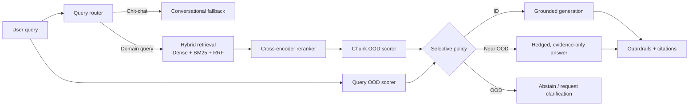

**OOD Aware RAG: Confidence Calibrated Generation**
> A retrieval-augmented generation system that knows when its evidence is outside its trusted knowledge domain — and responds by answering, hedging, or abstaining instead of confidently guessing wrongly.

Most RAG systems answer every query the same way: retrieve, stuff into a prompt, generate. If the corpus doesn't actually cover the question, the model still confidently generates something — because nearest-neighbor retrieval always returns something, whether or not it's relevant. This project treats that as the real hallucination problem worth solving: rather than trusting retrieval blindly, every query and every retrieved chunk is scored against a statistically fitted reference distribution of the trusted corpus, using the same distributional-distance techniques (Mahalanobis distance, kNN density, energy-based scoring) used for out-of-distribution detection in computer vision. When a query falls outside that distribution, the system says so explicitly instead of guessing.
This prevents the LLM from hallucinating and fabricating false/irrelevant answers.

## Why it matters

| Standard RAG failure | OOD-Aware RAG response |
| --- | --- |
| An unrelated question still retrieves superficially similar text | Score the **query** against the trusted corpus before trusting retrieval |
| A nearest-neighbour result looks relevant but is statistically atypical | Score each retrieved chunk using global and local embedding-space signals |
| The model has insufficient evidence but generates anyway | Select `generate`, `hedge`, or `abstain` based on the OOD policy |
| Confidence is hidden behind a hard decision | Return calibrated `P(OOD)`, an empirical confidence interval, and an OOD band |
| A corpus changes or its scope is incomplete | Use high-OOD traffic as a measurable signal for corpus gaps and drift |

This is especially useful for research assistants, internal knowledge bases, regulated-domain copilots, and any RAG application where an honest *“this corpus does not cover that”* is safer than an elegant fabrication.

## System architecture



## Repository layout

```text
.
├── build_index.py          # Build Chroma text/image indexes from the corpus manifest
├── hybrid_retrieval.py     # Dense + BM25 + RRF + cross-encoder retrieval
├── ood_scoring.py          # Fit, evaluate, save, load, and score OOD references
├── query_router.py         # Chit-chat vs corpus-routing decision
├── agent.py                # End-to-end selective RAG orchestrator
├── guardrails.py           # Prompt-injection flags, grounding, citations, reproducibility
├── generator.py            # Extractive and OpenAI-compatible generators
├── app.py                  # FastAPI service and frontend entry point
├── corpus_selection.py     # Corpus construction / tier selection
├── corruptions.py          # Controlled corruption utilities
├── eval_retrieval.py       # Retrieval ablations and tier-precision evaluation
└── test_ood_scoring.py     # OOD scoring tests
```

## Quick start

### 1. Clone and create an environment

```bash
git clone https://github.com/arpit196/OODRAG.git
cd RAG-OOD

python -m venv .venv
source .venv/bin/activate       # Windows PowerShell: .venv\Scripts\Activate.ps1
python -m pip install --upgrade pip
pip install chromadb sentence-transformers rank-bm25 fastapi "uvicorn[standard]" python-dotenv pillow
```

The first run downloads the embedding and reranking models used by the prototype:

- `all-MiniLM-L6-v2` for text embeddings
- `cross-encoder/ms-marco-MiniLM-L-6-v2` for reranking

### 2. Build the vector index

If you are using the included corpus, build the index with:

```bash
python build_index.py --corpus ./corpus --index ./chroma_index
```

`build_index.py` expects `corpus/manifest.json` entries with `tier`, `modality`, `path`, `title`, and `source` fields. Text tiers should include a trusted `id_core_text`, which is a set of in-domain documents; optional `near_ood_*` and `far_ood_*` tiers enable probability calibration and evaluation.

### 3. Fit and evaluate the OOD reference

```bash
python src/ood_scoring.py \
  --index ./chroma_index \
  --collection text_chunks \
  --query_ref ./query_reference.json \
  --output ./ood_reference.npz
```

This fit an enery-based model (Gaussian mixture model) on the set of in-domain distributions, which helps in identifying queries or documents that are out-of-distribution. By default, the fit process holds out 10% of each ID/OOD tier and reports energy and kNN AUROC. Set `--eval-fraction 0` only when you explicitly want to fit on all available labelled data.

### 4. Inspect confidence-aware retrieval

```bash
python src/hybrid_retrieval.py \
  --index ./chroma_index \
  --ood-reference ./data/ood_reference2.npz \
  --query "How does domain generalization handle distribution shift?"
```

Try an obviously off-topic prompt to verify the failure-safe path:

```bash
python src/hybrid_retrieval.py \
  --index ./chroma_index \
  --ood-reference ./data/ood_reference.npz \
  --query "What is a good recipe for vegetarian lasagna?"
```

### 5. Run the end-to-end agent

The extractive backend needs no API key and is useful for validating the complete policy flow:

```bash
python src/agent.py \
  --index ./chroma_index \
  --ood-reference ./data/ood_reference.npz \
  --generator extractive \
  --query "Explain invariant risk minimization."
```

For interactive chat, omit `--query`.

To use an OpenAI-compatible endpoint, create a local `.env` file:

```bash
OPENAI_API_KEY=your_key_here
# Optional: Ollama, vLLM, Groq, or another OpenAI-compatible endpoint
# OPENAI_BASE_URL=https://api.openai.com/v1
```

Then use `--generator openai`.

## Project Demo


# Optional Stage 2 grounding gate

The OOD agent now supports a post-retrieval classifier before its existing
prompt construction and generation. `src/generator.py`, prompt templates,
and citation behavior are unchanged. The standard baseline agent remains
unchanged. Existing `RAGAgent` callers keep their behavior until a grounding
model is configured; `ThreeStageRAGPipeline` requires a model path.

Train using the supplied OOD queries and real retrieval results:

```powershell
python train_grounding.py --queries data/grounding_queries.json --id-documents corpus/id_core_text/combined_documents.txt --index chroma_index --ood-reference data/ood_reference5.npz --output data/grounding.joblib
$env:RAG_GROUNDING_MODEL_PATH = "data/grounding.joblib"
$env:RAG_GROUNDING_THRESHOLD = "0.5"
# Start the API with your usual command, or use:
python -m src.agent --index chroma_index --ood-reference data/ood_reference5.npz --grounding-model data/grounding.joblib --query "What is domain generalization?"
```

`data/grounding_queries.json` contains the user-supplied 60 near-OOD and 30
far-OOD queries. Both groups have label **0 = reject**, even when retrieval
returns topically related ID chunks. By default, the script derives one
title-based question from each of the 150 ID papers in `combined_documents.txt`
and labels it **1 = ID**. Add an `id` query list to the JSON to use explicitly
labeled ID questions instead. Paper-title questions are ID proxies; validation
on them does not establish performance on arbitrary user questions.

For every example, `RAGAgent.collect_grounding_example()` computes real
Stage 1 scores, runs the existing dense/BM25/fusion/reranker pipeline, annotates
chunk OOD, and uses the same evidence selection and feature extraction as the
online gate. It never calls generation or the existing grounding classifier.
Offline collection deliberately retrieves even if Stage 1 would reject, and
records `stage1_would_reject`; online early rejection remains unchanged. Labels
come from the query groups and ID source documents, not chunk tiers or model
predictions. No random feature scores are generated.

Training saves `grounding.joblib`, auditable query/context/feature rows in
`grounding.training.jsonl`, and held-out metrics in `grounding.report.json`.
The scaler and classifier fit only the 80% training split, stratified by
ID/near-OOD/far-OOD. The report also evaluates only queries that passed Stage 1.
Choose the online threshold using validation relevant to deployment. The
training script's `--threshold` affects its report; set the online threshold
separately with `RAG_GROUNDING_THRESHOLD`. Load only trusted joblib files. A
configured missing or incompatible model raises instead of disabling the gate.

```python
from src.agent import ThreeStageRAGPipeline

pipeline = ThreeStageRAGPipeline(
    index_dir="chroma_index",
    ood_reference_path="data/ood_reference5.npz",
    grounding_model_path="data/grounding.joblib",
    grounding_threshold=0.5,
)
response = pipeline.run("What is domain generalization?")
print(response.response_text, response.execution_path)
print(response.debug_metadata["grounding_metrics"])
```

`answer()` retains the existing response dictionary and adds `execution_path`
and `grounding_metrics`. `run()` returns a typed `PipelineResponse`. Far-OOD
queries stop before retrieval; insufficient grounding stops with
"No relevant context found." and no generator call. Chitchat retains its
existing retrieval bypass. Existing OOD action decisions still apply.

`extract_grounding_features(query, top_3_chunks, stage1_features)` returns a
15-element NumPy vector in `src.grounding.FEATURE_NAMES` order: five Stage 1
signals, three cosine similarities, three normalized BM25 scores, cosine
max/mean/min, and chunk count. Online scoring computes actual cosine from
stored chunk vectors and the query embedding, including sparse-only hits,
and supplies BM25 scores even for dense-only hits. BM25 is transformed with
`max(score, 0) / (1 + max(score, 0))`. Missing ranks are padded with zeros;
aggregates use present chunks. The gate evaluates up to three chunks allowed
by the existing OOD chunk filter; those same chunks reach generation.

The model and feature names are serialized together and checked when loaded.
Training uses `StandardScaler` and `LogisticRegression`; inference returns
the class-1 probability. No classifier or embedding model is loaded per request.
Restart the service after changing the model or threshold so the process-local
answer cache is rebuilt.

Offline validation: `python -m unittest discover -s tests -p test_grounding.py`.

If the model was trained with a different scikit-learn version than your
runtime, refit the saved real-retrieval rows inside your active environment:

```sh
python train_grounding.py --training-rows data/grounding.training.jsonl --output data/grounding.joblib
python test_pipeline_e2e.py
```

This skips retrieval and generation and reuses the existing labels and features.
New artifacts record library versions; incompatible models fail during loading
with a refit command. Keep training and inference in the same environment.

