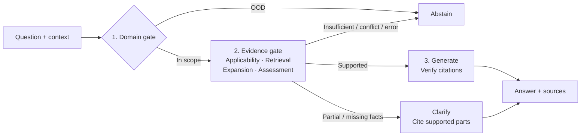

# Insurance RAG: answers with evidence, clarification when it matters

A UK home-insurance assistant that checks policy applicability and evidence before returning either a **cited answer, partial response, clarification request, or abstention**.

**Python · FastAPI · LangChain · Chroma · BM25 · SentenceTransformers · OpenAI · Docker**

[Demo walkthrough]([INSURANCE_DEMO.md](https://youtu.be/Qyp8kCBT690)) · [Docker setup](DOCKER_INSURANCE.md) · [Evaluation guide](BENCHMARK_EVALUATION.md)

## Why this project?

Many RAG systems retrieve relevant text and generate an answer without explicitly checking whether the evidence is sufficient, applicable, or contradictory. In insurance, a plausible answer can still misrepresent policy terms or assume customer-specific cover, potentially leading to incorrect claims decisions, financial loss, and loss of customer trust.
This project makes when to answer — and when to ask for more information — an explicit decision. It checks policy applicability and evidence for each part of a question, provides cited answers where supported, and identifies unresolved details through partial responses, clarification requests, or abstaining from answering with a clear, structured response.

- **Three-stage controls:** embedding-based out-of-domain detection, policy applicability and evidence assessment, then generation with citation checks.
- **Policy-aware retrieval:** dense + BM25 retrieval with reciprocal-rank fusion, document scope checks and bounded expansion for related definitions and conditions.
- **Useful partial responses:** cite supported information while identifying missing evidence, customer facts or conflicts.
- **Inspectable sources:** chat interface, cited document/page pane and compact decision JSON.
- **Measurable behavior:** stage timings, token usage, estimated cost when prices are supplied, regression tests and a standard-RAG comparison mode.

The first stage in the pipeline identifies whether a query is out-of-domain and abstains straight away, stating the query is out-of-domain (OOD) knowledge (e.g. What is the capital of France?), thus preventing token cost and unnecessary LLM generation.
An unanswered home-insurance question remains in domain. Domain detection and evidence sufficiency are separate decisions. Standard RAG can also abstain; the contribution here is explicit controls and diagnostics, not guaranteed hallucination prevention.

## How it works



## Run the chat demo

Bash/WSL commands, from the repository root. Python 3.12 is used by the CI/container setup.

```bash
git clone https://github.com/arpit196/OODRAG.git
cd OODRAG
python -m venv .venv
source .venv/bin/activate
python -m pip install -r requirements.txt
```

**Data prerequisite:** a code checkout alone is not a ready-to-run model. You will need an OpenAI API key for the LLM generation (you can get one from https://openai.com/) and prepare a matching artifact set:

| Path | Purpose |
| --- | --- |
| `insurance_chroma_index_v3/` | Chroma collection `insurance_chunks` |
| `data/home_insurance_scope.json` | Reviewed document allowlist, model and corpus fingerprint |
| `data/home_insurance_ood.npz` | Detector fitted to that corpus/scope |
| `real_insurance_corpus_v2/` | Manifest, extracted documents and original PDFs for the viewer |

Use the Chroma version that created the index. Large/source artifacts are not assumed to be included in the GitHub checkout. See [artifact preparation](INSURANCE_DEMO.md#prepare-the-artifacts). The UI uses these canonical paths; evaluation supports alternative paths.

```bash
read -rsp "OpenAI API key: " OPENAI_API_KEY; echo
export OPENAI_API_KEY
export INSURANCE_ALLOW_MODEL_DOWNLOAD=1  # First run downloads the embedding model
export INSURANCE_MODEL=gpt-4o-mini
python -m uvicorn ui.insurance_app:app --host 127.0.0.1 --port 8000
```

Open **http://127.0.0.1:8000** after startup. `/readyz` reports readiness. Chat requests use a paid API.

Try these using the default general customer context:

| Question | What to inspect |
| --- | --- |
| What is the trace and access limit under LV= buildings insurance? | Answer, citation and matching policy page |
| What is my exact LV escape-of-water excess? My personal details document is unavailable. | No invented amount; missing customer evidence explained |
| Explain trace-and-access cover, then tell me my exact escape-of-water excess. My personal details document is unavailable. | Supported information separated from unresolved details |
| What does Direct Line Home Insurance cover for subsidence? | Missing-policy refusal when that wording is absent from scope |
| Explain how to train a transformer model in PyTorch. | Out-of-domain abstention |

These are demo checks, not recorded outputs or guaranteed decisions. Each UI question is independent; displayed chat history is not model memory. The source pane displays available answer citations, not every retrieved chunk.

## Evaluate it

## Measured results

Recorded development results, **18 October 2026**, using the repaired insurance index. Domain detection is evaluated separately from evidence retrieval; near/far-OOD rejection is not a retrieval-recall metric.

| Component | Metric | Result | Evaluated cases |
| --- | --- | ---: | ---: |
| Stage 1 domain gate | Far-OOD rejection recall | **100%** | 8/8 rejected |
| Stage 1 domain gate | Near-OOD rejection recall | **12.5%** | 1/8 rejected |
| Stage 1 domain gate | In-domain acceptance | **93.75%** | 15/16 accepted |
| Initial retrieval | Document Recall@10 | **100%** | 41 eligible queries |
| Initial retrieval | Evidence Recall@10 | **77.5%** | 40 annotated eligible queries |
| Initial retrieval | Evidence MRR | **0.521** | 40 annotated eligible queries |
| Guarded request | Median / P95 / P99 latency | **4.72s / 10.43s / 14.20s** | 54 attempts |
| Guarded request | Recorded technical error rate | **0%** | 0/54 attempts |

[Recorded metrics and example responses](docs/insurance_demo_results.json). The 54-query benchmark and the separate 32-query synthetic Stage 1 test have different denominators. Near-OOD rejection at Stage 1 remains a limitation; later applicability/evidence gates can reject queries that pass it. Missing gold annotations are excluded, not scored as zero. Evidence recall measures retrieval of annotated passages, not answer faithfulness or extraction accuracy. Request latency excludes initialization; zero recorded technical errors does not mean zero incorrect answers.

Offline regression tests require no API calls. Install their dependencies in a separate environment:

```bash
python -m venv .venv-ci
.venv-ci/bin/python -m pip install -r requirements-ci.txt
.venv-ci/bin/python scripts/run_ci_tests.py
```

With the runtime environment and matching artifacts prepared:

```bash
python evaluate_insurance_benchmark.py --validate-only

# Small end-to-end smoke test; output directories must be new.
python evaluate_insurance_benchmark.py --pipeline guarded \
  --allow-model-download --limit 3 --output-dir benchmark_results/demo_smoke

# 54 cases, both variants: 108 attempts at one repeat.
python evaluate_insurance_benchmark.py --pipeline both \
  --allow-model-download --repeats 1 --output-dir benchmark_results/demo_comparison
```

For custom/repaired artifacts, supply `--index`, `--scope` and `--ood-reference` together. Add `--prices path/to/prices.json` with a valid dated price table; unmeasured cost stays blank.

Exports include `per_query_results.csv`, `retrieved_results.csv`, `aggregate_metrics.csv`, `raw_results.jsonl`, `simple_results.json`, `report_summary.json` and `manual_review.csv`.

Report document Recall@K separately from evidence Recall@K and evidence MRR, with denominator counts. Missing evidence annotations stay blank. Retrieval metrics describe initial retrieval, not expanded evidence. Review correctness, completeness and citation support manually: `generate` does not prove an answer is correct. Compare variants on the same eligible cases.

## Main modules

| File | Responsibility |
| --- | --- |
| `ui/insurance_app.py`, `ui/insurance.html` | API, chat and document viewer |
| `src/agent.py` | Guarded and standard insurance orchestration |
| `src/ood_scoring.py` | Fit and score the insurance domain detector |
| `insurance_retrieval_fixed.py` | Insurance indexing and hybrid retrieval |
| `src/evidence_gate.py` | Applicability, expansion, assessment and decisions |
| `src/generator.py`, `src/guardrails.py` | Generation and citation checks |
| `evaluate_insurance_benchmark.py` | Evaluation exports |
| `report_insurance_results.py` | Compact results and manual-review reporting |

## Limitations and contributions

This is a portfolio/research implementation, not an automated claim adjudicator. Parsing errors, retrieval misses and assessment errors can still cause incorrect answers or unnecessary abstention. Regulatory material participates only when allowlisted; inspect scope before claiming FCA/FOS coverage.

Before public deployment, add authentication, request/spending limits and server-side customer-record verification. A browser-provided `verified: true` is not authentication. See [AWS deployment notes](AWS_QUICKSTART.md).

Found an incorrect answer or unnecessary abstention? Open an issue with a public-policy example, expected behavior and source reference, without customer data or secrets. Contributions to held-out evaluations and source extraction are especially welcome.

The earlier research-domain documentation is preserved in [README_RESEARCH.md](README_RESEARCH.md).
